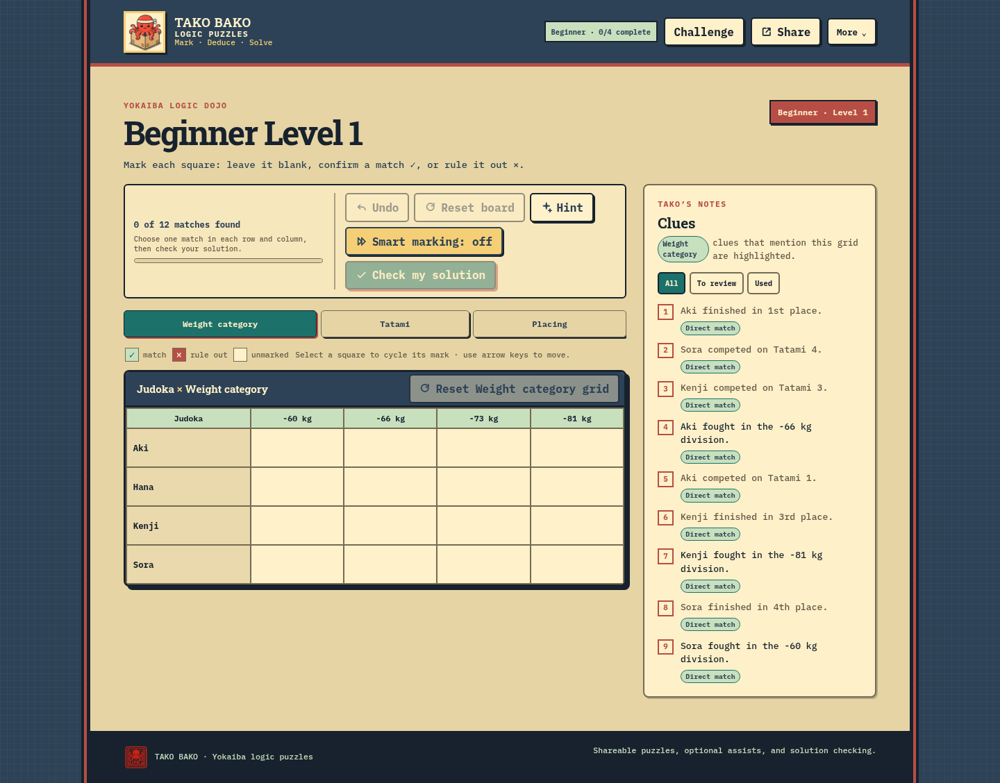

[](https://github.com/CyanAutomation/tako-bako/actions/workflows/ci.yml) [](https://github.com/CyanAutomation/tako-bako/actions/workflows/workflow-validation.yml) [](https://github.com/CyanAutomation/tako-bako/actions/workflows/deployment-smoke.yml)

# Tako Bako

A browser-based logic grid game for puzzle fans. Solve zebra and Einstein-style puzzles by marking matches and eliminating possibilities until each category has one solution.

[Play Tako Bako](https://tako-bako.vercel.app/)



## Contents

- [Quick start](#quick-start)
- [How to play](#how-to-play)
- [Puzzle Challenge](#puzzle-challenge)
- [Development](#development)
- [Deployment and API](#deployment-and-api)
- [Configuration](#configuration)
- [Project structure](#project-structure)
- [Contributing and support](#contributing-and-support)

## Quick start

**Prerequisite:** Node.js `^24.0.0`.

```sh
npm ci
npm run dev
```

Open <http://localhost:5173>. The Vite development server proxies puzzle generation to Yokaiba and requires network access. It does not run Vercel's serverless handlers, so answer checking and server-assisted hints and clue labels are available in the deployed app. Local play and puzzle generation need no provider credentials; optional model-assisted features require server-side configuration when deployed.

If puzzle generation fails, check network access to Yokaiba and inspect the `/api/puzzle` response in your browser's developer tools. See [operations troubleshooting](docs/operations.md#local-troubleshooting) for more help.

## How to play

Each puzzle has several categories of clues, such as “The cat owner lives next door to the fish keeper” or “The Swiss plays tennis.” Use the grid to record what you know:

1. **Mark or eliminate:** Click a square to cycle through blank, match (✓), and ruled out (×). The readiness meter counts confirmed matches; submit when it is full.
2. **Undo:** Revert the last mark. Use **Clear grid** to remove marks from one grid or **Clear board** to clear every grid; confirm before clearing. Undo can restore cleared marks. Starting another puzzle or returning to the landing page clears the undo history.
3. **Smart marking:** Turn it on in the board toolbar to rule out the other squares in a row and column when you confirm a match.
4. **Check:** Submit a complete board. The server verifies it with Yokaiba; a correct answer advances Puzzle Challenge progress.
5. **Rate the difficulty:** After solving, optionally choose Too easy, Just right, or Too hard. A Too hard rating can include one optional reason. While solving, open **More → Give feedback** to rate an unfinished puzzle.
6. **Share:** Copy the page URL to share the same seeded puzzle. Challenge links include tier and level; other shared links include a template and difficulty. Seeds accept 1–128 ASCII letters, digits, or hyphens; shared difficulty ranges from 1 to 12.

Four scenarios are available: Tournament Order (4×4 warm-up), Open Division (5×5), Championship Bridge (bridge to the expert board), and Championship Circuit (three expert grids). Older Tournament Order v1 links remain available; Open Division v1 and Championship Circuit v1 links open their current versions.

Clues can be filtered as All, To review, or Used. Used-clue status is saved separately from board marks. The clue panel identifies the active grid and highlights clues that mention it. Use arrow keys to move through grid cells. The grid collection is a labelled region; grid tabs, clue filters, board actions, and dialogs expose their names and selected state to assistive technology. Readiness feedback reports confirmed matches and whether the solution is ready to check.

### Puzzle Challenge

Puzzle Challenge guides players through twelve levels: Beginner uses Tournament Order 1–4; Intermediate uses Open Division 5–7 and Championship Bridge 8; Advanced uses Championship Bridge 9 and Championship Circuit 10–12. Each tier's introductory description is available from a labelled information disclosure. Levels unlock sequentially, and the header shows completion within the active tier. Hints begin with a clue and can offer an elimination or a revealed placement as progress increases. Daily puzzles roll over at midnight UTC and advance with a correct answer. Players can also replay a tier, start the daily puzzle fresh, or reset Challenge progress without deleting saved boards or breaking shared links.

## Development

Useful commands:

| Command | Purpose |
|---|---|
| `npm run check` | Lint, run tests, check README links and paths, and build the app and API |
| `npm run test` | Run the test suite |
| `npm run test:coverage` | Write V8 coverage under `coverage/v8` |
| `npm run lint` | Lint source files |
| `npm run build` | Type-check and build the app and API |
| `npm run preview` | Preview the production build locally |
| `npm run check:external-links` | Check external links in README and `docs/` (requires network access and `curl`) |

The full gate runs `npm run check`. For coverage-based CRAP scores, use the pinned tool command `npx --yes fallow@3.33.1 health --coverage coverage/v8`; it downloads the CLI without adding it to project dependencies. TypeScript checks run separately for the app (`tsconfig.app.json`), API (`tsconfig.api.json`), and Node tooling (`tsconfig.node.json`).

External links in the README and `docs/` are checked by a separate weekly workflow, or manually with `workflow_dispatch`. This check needs network access and `curl`, so it is separate from the normal pull-request gate.

For deployed route behavior and the health endpoint, see [Deployment and API](#deployment-and-api) and the [operations guide](docs/operations.md#deployment). Local and deployed service issues are covered in [operations troubleshooting](docs/operations.md#local-troubleshooting).

Selected test contracts and product behavior are mapped in [test traceability](docs/test-traceability.md). The focused test review and verification notes are in [test quality review](docs/test-quality-review.md).

## Deployment and API

Vercel serves the Vite app and six serverless handlers. Puzzle generation and answer verification share `/api/puzzle`; the other handlers provide hints, clue labels, anonymous outcome events, puzzle difficulty feedback, and readiness. See the [operations endpoint reference](docs/operations.md#deployment) for route methods and the [operations guide](docs/operations.md) for caching, security headers, and provider configuration.

`GET /api/puzzle` accepts a required `seed`, an optional allow-listed `templateId`, and an optional `difficultyLevel` from 1 to 12. Verification (`POST /api/puzzle`) and hints (`POST /api/hint`) require the signed `puzzleToken` returned with a generated puzzle. These endpoints support the app's own flows.

Check the deployed app and its required Yokaiba dependency with:

```sh
curl -i https://tako-bako.vercel.app/api/health
```

A ready service returns HTTP 200 and:

```json
{"status":"ok","dependencies":{"yokaiba":"ok"}}
```

If Yokaiba is unavailable, the endpoint returns HTTP 503 with `status: "degraded"` and `dependencies.yokaiba: "unavailable"`. This example checks the deployed Vercel handler; the Vite dev server does not serve `/api/health`.

## Configuration

Playing locally does not require API keys. Puzzle generation is available without optional model services. Answer verification and puzzle feedback require Yokaiba's signed puzzle token and its configured D1 feedback binding. Jev's optional clue labels and hint selection require `OPENROUTER_API_KEY`, `UPSTASH_REDIS_REST_URL`, and `UPSTASH_REDIS_REST_TOKEN` in the Vercel server-side environment. `JEV_MODEL` is optional. Keep credentials out of browser code and the repository.

See [operations and configuration details](docs/operations.md) for defaults, rate limits, fallback behavior, cache policy, and security notes.

## Project structure

```text
src/                       Browser application
  main.ts                  Browser entry point
  app.ts                   State, events, rendering, persistence
  app-routing.ts           URL routing for play modes and settings
  app-requests.ts          Browser API requests
  puzzle-board/            Board marking and solution helpers
  puzzle-cache/            Puzzle response cache and freshness policy
  sections/                Board, clue, curriculum, and grid views
api/                       Vercel serverless handlers
server/                    Shared API and provider modules
tests/api/                 API handler tests
docs/                      Operations and test documentation
  images/                  README gameplay screenshot
scripts/                   Test runner and documentation checks
vite.config.ts             Development server and puzzle proxy
vercel.json                Deployment, security headers, and caching
```

## Contributing and support

The hosted game is available at [tako-bako.vercel.app](https://tako-bako.vercel.app/). The project does not currently publish a supported-browser matrix; include your browser name and version when reporting an issue.

Report bugs or request features in [GitHub Issues](https://github.com/CyanAutomation/tako-bako/issues). For code changes, open a pull request and run `npm run check` before submitting. The project is licensed under [GNU GPL v3](LICENSE).
